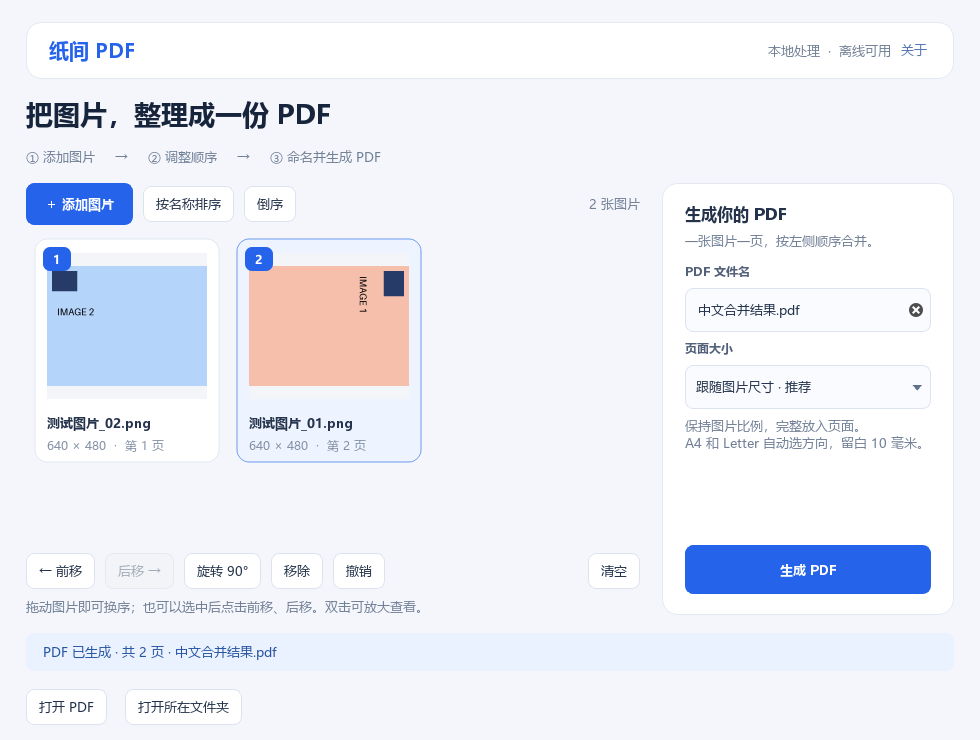

# 纸间 PDF · PaperDesk

一个中文、离线使用的 Windows 图片转 PDF 桌面工具。把图片拖入窗口，调整顺序，填写文件名，即可生成一份 PDF。

**本项目基于 [PDF Arranger 1.14.0](https://github.com/pdfarranger/pdfarranger/tree/1.14.0) 的部分图片转换与页面变换源码二次开发，使用 GPL-3.0-or-later 许可证。** 项目由 [@zhangyuankun01](https://github.com/zhangyuankun01) 发起并维护，界面和图片整理流程采用 AI 辅助开发。



## 下载与打开

Windows 64 位便携版：[前往 Releases 下载](https://github.com/zhangyuankun01/paperdesk/releases/latest)。

1. 下载 `PaperDesk-2.1.0-windows-x64.zip`。
2. 右键压缩包，选择“全部解压”，等待解压完成。
3. 打开解压后的 `PaperDesk-2.1.0` 文件夹，双击 `PaperDesk.exe`。

请完整保留程序旁边的 `_internal` 文件夹。使用便携版无需安装 Python，也无需注册账号。GitHub 页面上的 **Code → Download ZIP** 下载的是源码；直接使用软件请下载 **Releases** 中的便携包。

详细步骤见 [使用教程](docs/使用教程.md)。

## 功能

- 中文界面：按“添加图片 → 调整顺序 → 命名并生成”组织操作。
- 拖入多张图片，显示缩略图与最终页码；双击可放大预览。
- 拖动换序、前移/后移、按文件名自然排序、倒序。
- 旋转 90°、移除、清空与撤销；整理列表会保留原始图片。
- 自定义 PDF 文件名，选择原图尺寸、A4 或 Letter。
- A4 / Letter 自动判断横竖方向，保持图片比例并留出 10 毫米边距。
- 后台读取与导出、中文提示、重复文件跳过、临时文件保存后替换目标文件。
- 图片在本机处理，无上传服务或付费接口依赖。

支持以下图片格式：

- 手机照片：**HEIC / HEIF / HIF**、JPG / JPEG / JFIF。
- 常用图片：PNG / APNG、WebP、BMP / DIB、GIF、TIFF。
- 其他图片：AVIF、JPEG 2000（JP2 / J2K）、ICO、PCX、TGA、PPM / PGM / PBM / PNM、DDS、QOI、PSD 合成图。

HEIC 解码器已内置，无需购买或安装 Windows 图片扩展。文件名为大写扩展名、扩展名不标准或没有扩展名的图片，也会按实际内容识别；在选择窗口切换到“所有文件”即可找到它们。

多帧图片使用首帧，HEIC / HEIF 使用文件指定的主图；PSD 使用合成预览，导入后每个文件生成一页。手机照片按方向信息处理，10 / 12 位 HEIF 会解码为普通 8 位图片用于 PDF，不保留 HDR 动态范围。SVG、相机 RAW 和磁盘镜像不在此版本支持范围内。

## 维护者与贡献

项目发起与维护：[@zhangyuankun01](https://github.com/zhangyuankun01)。

本项目的贡献主要包括：

1. 确定中文图片合并工具的使用场景、功能需求和低成本实现范围。
2. 设计并实现面向普通用户的中文桌面界面、编号预览和三步导出流程。
3. 将上游处理函数适配到独立的 Qt 前端，整合排序、旋转、撤销、命名和纸张设置。
4. 增加图片暂存、重复检测、导出失败保护，以及中文使用提示。
5. 完成 Windows 便携版打包、转换测试、打包程序验收和接收者使用教程。
6. 整理开源来源、许可证、贡献记录和 GitHub 发布材料。

代码实现、调试、测试及文档编写由维护者使用 **OpenAI Codex 辅助完成**。详细归属见 [贡献说明](CONTRIBUTORS.md)。

## 二次开发来源

上游项目：[pdfarranger/pdfarranger](https://github.com/pdfarranger/pdfarranger)。

- 基准版本：`1.14.0`
- 固定提交：[`29f306bb6932e28d3001b098f6dad9824ab74100`](https://github.com/pdfarranger/pdfarranger/commit/29f306bb6932e28d3001b098f6dad9824ab74100)
- 上游许可：`GPL-3.0-or-later`

| 本项目文件 | 来源或本项目工作 |
| --- | --- |
| `paperdesk/pdfarranger_port.py` | 从上游 `core.py`、`exporter.py` 提取并适配图片转换、矩形边界、缩放和旋转函数，保留原版权声明。 |
| `paperdesk/engine.py` | 本项目的图片导入与暂存、输出选项、文件名检查和原子保存逻辑。 |
| `paperdesk/window.py` | 本项目的中文 Qt 界面、图片卡片、拖放排序和操作流程。 |
| `tests/`、`paperdesk/selftest.py` | 本项目的转换与界面交互检查、打包程序自检。 |

此版本聚焦图片合并流程，功能范围不包含原 PDF Arranger 的全部 PDF 编辑功能。上游的原始贡献与复用范围详见 [来源记录](third_party/PDF_ARRANGER_SOURCE.txt)。

## 从源码运行

使用 Python 3.11，在项目根目录执行：

```powershell
python -m venv .venv
.\.venv\Scripts\python.exe -m pip install -r requirements.txt
.\.venv\Scripts\python.exe main.py
```

## 验证

```powershell
.\.venv\Scripts\python.exe -m pytest -q
.\.venv\Scripts\python.exe main.py --self-test .\acceptance
```

`--self-test` 使用独立的离屏窗口，输出验收记录、界面预览和测试 PDF。源码测试覆盖中文路径、图片导入、拖动启动与换序、旋转、撤销、文件名及 PDF 输出；新增格式测试核对真实 HEIC / HEIF、AVIF 等图片转换后的尺寸和像素。打包自检也会实际解码图片并生成混合格式 PDF，用于发现便携包遗漏解码库的问题。

## 打包

```powershell
.\.venv\Scripts\python.exe -m PyInstaller --noconfirm PaperDesk.spec
```

产物位于 `dist/PaperDesk/`。所附 spec 会排除可能由本机其他软件带入的不兼容 ICU 文件；Windows 版 Qt 使用系统提供的 ICU。

## 许可证

本项目使用 **GPL-3.0-or-later**，完整条款见 [LICENSE](LICENSE)。上游版权说明保留在衍生代码中；第三方组件及来源见 [THIRD_PARTY_NOTICES.md](THIRD_PARTY_NOTICES.md)。发布的便携包包含本项目源码、上游基准源码、许可证和使用教程。
